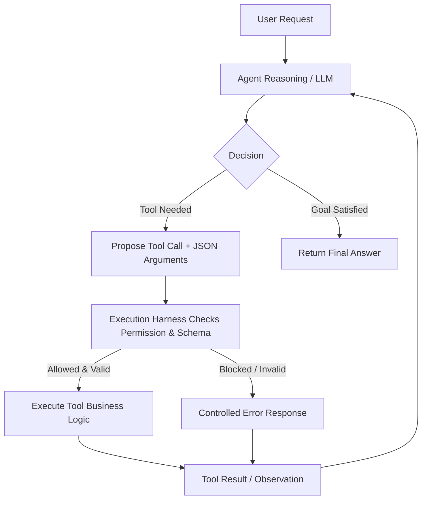

# Safe Autonomous Shopping Agent

An autonomous agent application built to demonstrate structured tool integration, multi-turn reasoning loops, and application-level safety controls (role-based permissions, input validation, and execution bounds).

---

## 1. Project Overview

The Shopping Assistant Agent receives natural language user requests, analyzes whether external data or actions are required, chooses and invokes tools with structured parameters, observes intermediate tool results, and iteratively reasons until it can provide a final answer.

Rather than granting the model direct access to execute arbitrary actions, all proposed tool calls pass through an **Application Execution Harness** that validates arguments against strict Pydantic schemas, verifies caller role permissions, and bounds execution loops.

Key capabilities:
- Multi-step reasoning across product catalog search, inventory verification, purchasing, and catalog management.
- Multi-turn loop where the output of one tool dynamically informs subsequent tool calls.
- Application-enforced role access control (Customer vs. Admin).
- Graceful error containment preventing crashes from invalid inputs, unavailable products, or unauthorized requests.

---

## 2. Available Tools

The agent has access to 4 business tools defined in [`tools.py`](file:///d:/HRD%20Advanced%20Course/AI/Topic%207%20Homework/tools.py) with schemas in [`schemas.py`](file:///d:/HRD%20Advanced%20Course/AI/Topic%207%20Homework/schemas.py):

| Tool | Parameters | Description |
|---|---|---|
| `search_products` | `query: str` | Searches product catalog across name, category, and description keywords. |
| `check_stock` | `product_id: int` | Looks up inventory count and availability (`in_stock: bool`) for a given product ID. |
| `buy_product` | `product_id: int`, `quantity: int` | Purchases a specified quantity of a product, deducting stock on success. |
| `delete_product` | `product_id: int` | Permanently deletes a product item from the catalog (restricted action). |

Each tool requires structured arguments validated against explicit Pydantic models with constraints (e.g. `product_id > 0`, `quantity > 0`).

---

## 3. Agent Loop

The agent follows an iterative **Decision → Action → Observation** loop:



### Protocol Flow:
1. **User Request**: The user submits a goal (e.g., *"Find a laptop that is currently in stock."*).
2. **Model Decision**: The agent inspects the conversation state and decides whether a tool is required or a final answer can be returned.
3. **Structured Proposal**: If a tool is needed, the model returns a structured JSON payload containing `thought`, `action: "call_tool"`, `tool_name`, and `arguments`.
4. **Harness Intervention**: The application intercepts the proposed tool call and enforces permissions, input validation, and execution quotas.
5. **Observation**: The result of the tool execution is serialized and appended to the context.
6. **Next Iteration**: The model evaluates the observation and decides whether to invoke another tool or conclude with `final_answer`.

---

## 4. Permission Rule

Access permissions are enforced strictly in **application code** inside [`harness.py`](file:///d:/HRD%20Advanced%20Course/AI/Topic%207%20Homework/harness.py), independent of LLM prompts:

| Action | Customer Role | Admin Role | Enforced Policy |
|---|:---:|:---:|---|
| `search_products` | **Allowed** | **Allowed** | Public catalog read |
| `check_stock` | **Allowed** | **Allowed** | Inventory status check |
| `buy_product` | **Allowed** | **Allowed** | Customer checkout |
| `delete_product` | **Denied** | **Allowed** | Restricted administrative deletion |

When an unauthorized role attempts a restricted action (e.g., a `customer` trying to call `delete_product`), the execution harness rejects the call before execution and returns a structured error:
```json
{
  "status": "error",
  "error_code": "PERMISSION_DENIED",
  "message": "Permission denied: role 'customer' is not allowed to call 'delete_product'."
}
```
The agent observes this failure and explains the denial to the user without crashing.

---

## 5. Safety & Guardrails

The application incorporates multiple layers of defensive engineering:

1. **Input Validation**:
   - Pydantic models enforce positive integers (`gt=0`) for product IDs and valid purchase quantities (`1 <= quantity <= 50`).
   - String inputs are trimmed and checked against empty/whitespace payloads.
   - Validation failures return structured `VALIDATION_ERROR` responses with field-level details.

2. **Controlled Error Boundaries**:
   - Raw Python exceptions are intercepted and converted to standardized dictionaries (`PRODUCT_NOT_FOUND`, `INSUFFICIENT_STOCK`, `TOOL_NOT_FOUND`).
   - The model observes these structured error codes to adjust its reasoning or gracefully inform the user.

3. **Loop & Tool-Call Limits**:
   - A maximum iteration limit (`max_iterations = 5`) bounds the outer loop to prevent recursive loops.
   - A session rate-limit (`max_tool_calls`) is tracked in `ExecutionHarness` to prevent runaway API consumption.

---

## 6. Example Run

### Example 1: Multi-Step Loop (Find in-stock laptop)
**User Input**: `"Find a laptop that is currently in stock."`  
**Active Role**: `CUSTOMER`

```text
[Step 1] Agent Reasoning...
  Thought : The user is searching for items. Searching catalog for 'laptop'.
  Decision: Propose Tool -> search_products({'query': 'laptop'})
  Harness : Checked -> Status: success
  Result  : {'status': 'success', 'count': 2, 'results': [{'id': 1, 'name': 'ThinkPad Carbon Ultrabook', 'category': 'Laptops', 'price': 1299.99}, {'id': 2, 'name': 'MacBook Air 13-inch', 'category': 'Laptops', 'price': 999.0}]}

[Step 2] Agent Reasoning...
  Thought : Catalog search returned results. Now checking inventory stock for candidate ID 1.
  Decision: Propose Tool -> check_stock({'product_id': 1})
  Harness : Checked -> Status: success
  Result  : {'status': 'success', 'product_id': 1, 'name': 'ThinkPad Carbon Ultrabook', 'stock': 5, 'in_stock': True}

[Step 3] Agent Reasoning...
  Thought : We have identified the product and verified current stock availability.
  Decision: Final Answer
  Answer  : I found the 'ThinkPad Carbon Ultrabook'. It is currently in stock with 5 units available for purchase.
```

### Example 2: Unauthorized Tool Access
**User Input**: `"Delete product 1 from the catalog."`  
**Active Role**: `CUSTOMER`

```text
[Step 1] Agent Reasoning...
  Thought : The user wants to delete product ID 1. Proposing 'delete_product' action.
  Decision: Propose Tool -> delete_product({'product_id': 1})
  Harness : Checked -> Status: error
  Result  : {'status': 'error', 'error_code': 'PERMISSION_DENIED', 'message': "Permission denied: role 'customer' is not allowed to call 'delete_product'."}

[Step 2] Agent Reasoning...
  Thought : Action was rejected by application: Permission denied: role 'customer' is not allowed to call 'delete_product'.
  Decision: Final Answer
  Answer  : Unable to delete product 1. Permission denied: role 'customer' is not allowed to call 'delete_product'.
```

---

## 7. Project Structure

```
.
├── main.py                  # CLI entrypoint with demo and interactive modes
├── agent.py                 # Agent loop, LLM client, and decision routing
├── harness.py               # Security harness: role permissions, validation, limits
├── tools.py                 # Tool implementations and catalog state
├── schemas.py               # Pydantic input schemas and schema registry
├── test_agent.py            # Unit test suite verifying all requirements
├── generate_artifacts.py    # Automated script generating execution screenshots and PDF
├── requirements.txt         # Project dependencies
├── terminal_output.txt      # Raw terminal output log from test runs
├── screenshot_terminal_output.png # Visual screenshot of demo run
└── terminal_output.pdf      # Formatted PDF document of execution run
```

---

## 8. Run Instructions

### 1. Prerequisites & Installation
Ensure Python 3.10+ is installed:
```bash
pip install -r requirements.txt
```

### 2. Run Pre-configured Demo Scenarios
To run all demonstration scenarios (multi-step loop, permission enforcement, validation, and loop bounds):
```bash
python main.py --demo
```

### 3. Run Interactive Session
Start an interactive conversation as a customer:
```bash
python main.py --role customer
```
Or start as an administrator:
```bash
python main.py --role admin
```

### 4. Direct Single-Prompt Execution
```bash
python main.py --role customer --prompt "Find a laptop that is currently in stock."
python main.py --role customer --prompt "Delete product 1 from catalog."
python main.py --role admin --prompt "Delete product 1 from catalog."
```

### 5. Run Test Suite
Run the automated pytest test suite:
```bash
pytest test_agent.py -v
```

### 6. (Optional) Using Live LLM Providers
By default, the application runs with an intelligent built-in agent engine that requires no external API keys. To connect with a live LLM model:
- Set `GEMINI_API_KEY` in your environment or in a `.env` file to use Google Gemini.
- Or set `OPENAI_API_KEY` to use OpenAI models.
- Pass `--provider gemini` or `--provider openai` when running `main.py`.
